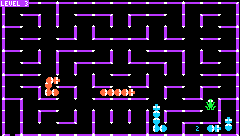

# Serpentine

Faithful recreation of Serpentine, a maze game like Pac-Man but with snakes! Originally written by David Snider and published by Broderbund for the Apple II in 1982. This remake attempts to preserve the gameplay, feel, and character of the original while making it easier to experience today.

## Gameplay
- Snake-vs-snake battles: bite enemy snakes from behind, and don't let them bite you!
- 20 different mazes
- Enemy snakes lay eggs that hatch into new snakes, so eat them first
- Frogs hop around the maze for bonus snacks
- Three difficulty levels (BOOMER, GEN-Y, ZOOMER)

## Controls
- Hit btn Ⓐ / key 🆉 to start the game or btn Ⓑ / key 🆇 for options.
- In game use arrows move your snake, that's it.

> AI Disclosure: AI was used to analyze the original game and to generate the code for the remake.
