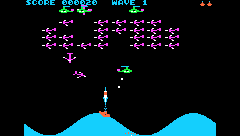

# Wavy Navy

A faithful recreation of Wavy Navy, a shoot-em-up originally written by Rodney McAuley and published by Sirius Software for the Apple II in 1983. This version preserves the gameplay, feel, and character of the original while making it easier to experience today.

## Game Features
- Gun platform on rolling waves!
- Intricate enemy plane dive attack maneuvers
- Multiple enemy types: planes, helis, mines, bombers, missles
- Detailed explosion animations
- Three difficulty levels (boomer, gen-y, zoomer)
- Plays nautical-themed musical tunes between levels

## Controls

- ← / → moves your boat left/right
- btn Ⓐ / key 🆉 fires

- From the title screen, press btn Ⓐ / key 🆉 to start the game, or btn Ⓑ / key 🆇 for the options screen.

- On the options screen, ↑ / ↓ picks a setting, btn Ⓐ (or ← / →) changes it, and btn Ⓑ goes back to the title:
  - **Difficulty**: boomer, gen-y or zoomer (takes effect from the next game)
  - **Theme**: Apple II color monitor, green phosphor or white (B&W) phosphor. On players without alternate display support, this option is greyed out, shows "UNAVAILABLE" and is skipped when selecting settings
  - **Reset hiscore**: press btn Ⓐ twice to clear the saved high score

The Apple II boot module returns `{alt_display = boolean}`, including when
the intro is disabled. Green/white rendering requires `vbank` and an enabled
overlay. Unsupported players use color without a screen-memory masking pass.
Saved green/white preferences are preserved for a supported player; they do
not activate the filter on an unsupported player.

> AI Disclosure: AI was used to analyze the original game and to generate the code for the remake.
